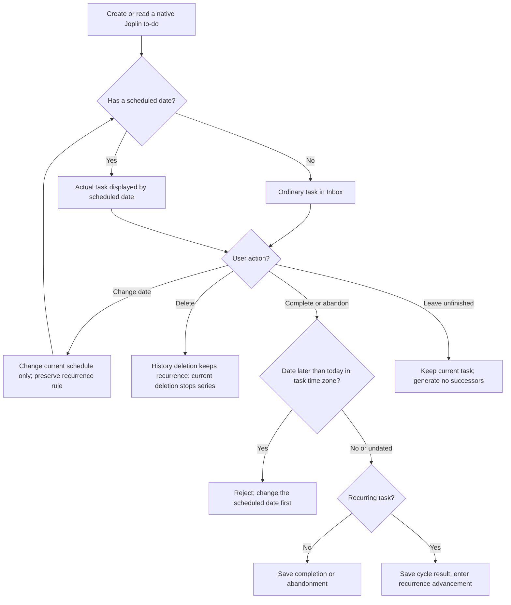
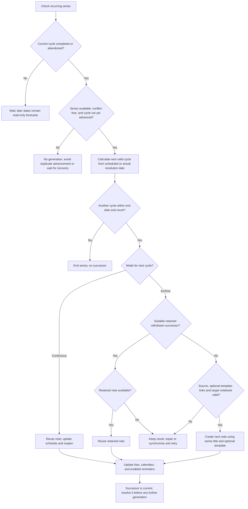
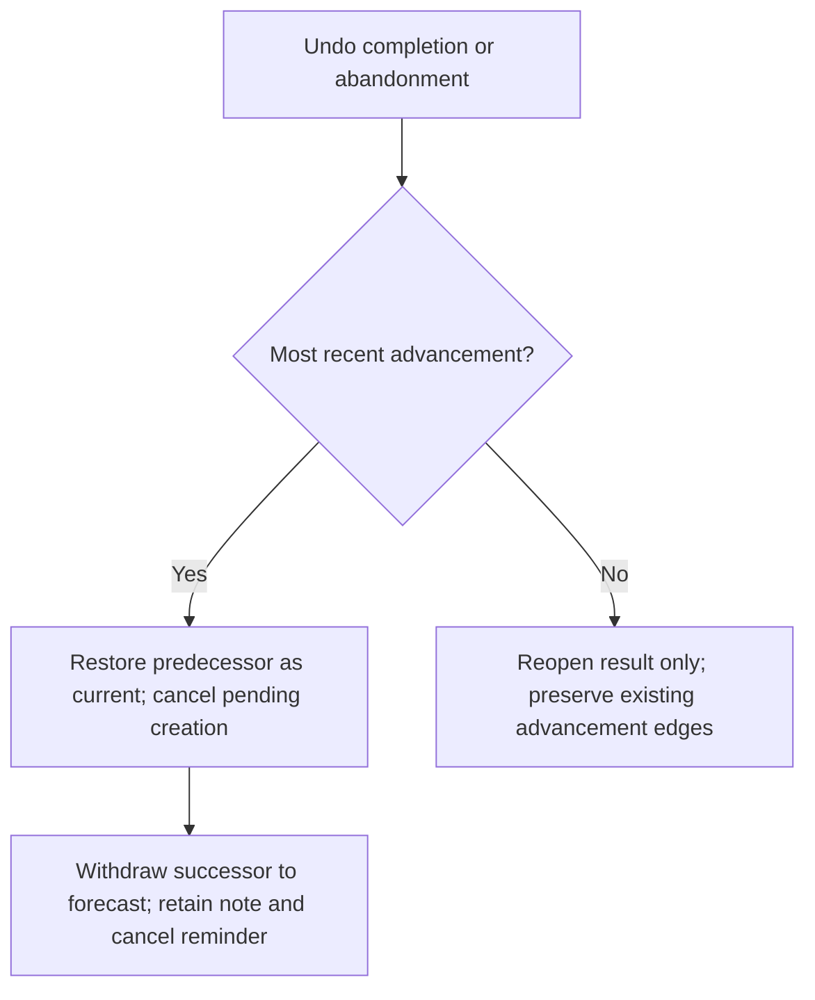

<h1 align="center">Journey Tasks for Joplin</h1>

<p align="center">Native Joplin to-dos in task lists and calendars.<br />Gregorian and Chinese lunar recurrence, per-cycle archives, and native reminders. Edit task bodies in Joplin's own editor.</p>

<p align="center">
  <a href="https://github.com/tigerwoo/journey-tasks-joplin-desktop/releases"></a>
  <a href="LICENSE"></a>
</p>

<p align="center"><strong>English</strong> · <a href="README.zh-CN.md">简体中文</a></p>

<p align="center"><strong>Joplin Desktop 3.3+ · macOS / Windows / Linux<br />Android and iOS are not supported.</strong></p>

## Screenshots

**Today:** pinned, overdue, and scheduled tasks in one list.


<details>
<summary>More screenshots: week, year, and task actions</summary>

**Week:** review completed tasks and upcoming recurring forecasts.


**Year:** see the distribution of tasks across the year.


**Task actions:** change dates, view the task log, pin, abandon, move, or delete a task.


</details>

## Core rules

- **The next actual recurring task is generated only after the current cycle is completed or abandoned.** Leaving it unfinished, letting it become overdue, refreshing, synchronizing, or browsing future dates does not generate subsequent tasks.
- **Expected calendar entries are read-only forecasts**, not generated tasks or notes. They cannot be completed or abandoned and have no reminders. An expected cycle can become an actual task only after its predecessor is resolved.
- **Future tasks cannot be completed or abandoned.** This applies to both ordinary and recurring tasks. The check compares the scheduled date with today's date in the task's time zone. Tasks scheduled today can be resolved before their scheduled clock time; undated ordinary tasks can be resolved directly. To act early, first move the actual task's date to today or an earlier day.
- Each resolution advances at most one cycle. The successor must itself be resolved before another is generated. Continuous mode reuses the note; archive mode creates a separate note. No successor is generated once the recurrence ends.

## Install and update

1. Download the [latest Journey Tasks installation package (`.jpl`)](https://github.com/tigerwoo/journey-tasks-joplin-desktop/releases/latest/download/io.journey.tasks.97d1cd8a-5ed4-4cc9-9bf8-f0b287db6cad.jpl). If the direct download is unavailable, check the [Releases page](https://github.com/tigerwoo/journey-tasks-joplin-desktop/releases) for a release containing a `.jpl` asset. You only need this file; do not extract it. Node.js and the adjacent publishing JSON files are unnecessary for installation.
2. In Joplin Desktop, open Settings / Options → Plugins → Plugin tools (gear) → Install from file.
3. Select the `.jpl`, then fully quit and restart Joplin when prompted.
4. Enable Journey Tasks. Open Tools → Journey Tasks → Show tasks if the panel is hidden. Menu wording follows the selected interface language.

Use Joplin's Change application layout command to position the panel and drag its divider to resize it. Narrow panels allow horizontal calendar scrolling.

The Journey route-and-check icon in Joplin’s top note toolbar toggles the entire panel, as does Tools → Journey Tasks → Show/hide tasks. Show tasks always opens it. On desktop, the top-left double-chevron hides the main panel and shows a 32px mini rail containing only an SVG restore button, releasing space for the editor. Restoring retains your view, filters, and main panel width. The toolbar toggle hides the mini rail when collapsed and opens the full panel when shown again. Expanded, collapsed, and hidden states are saved on this device and restored after restarting Joplin; first use opens the panel. The mini rail is an independent item in Change application layout; move it separately if needed. Vertical docking uses a 36px-high restore strip. Sizing relies on Joplin’s internal layout classes and may need updates after host upgrades. Hosts without the chrome stylesheet API keep the content-only fallback.

To update, install the newer `.jpl` and restart. Use the same version on all desktop devices managing a series.

## Get started

1. Open the panel, choose New, enter a title, and select a notebook.
2. Optionally set a scheduled date, time, and reminder. Undated tasks enter the Inbox; a date without a time is an all-day task.
3. Choose Save and open note. Add text, Markdown checklists, images, and attachments in Joplin.
4. Return to the panel to edit properties or check off an eligible task. Existing native Joplin to-dos appear automatically.
5. For recurrence, first save an unfinished task with a scheduled date, then enable recurrence and choose its rule and mode.

For quick capture, type a title into the quick-add bar and press Enter or its plus button. Its options select today, tomorrow, a custom date, or no date, and a default notebook. Quick-add creates an all-day or undated task with reminders off; open the task to add a time or recurrence.

Existing native to-dos use their native alarm as the initial scheduled time; those without an alarm enter the Inbox. Once managed by the plugin, planned dates and reminder overrides are stored separately. Ordinary notes are not automatically converted into to-dos.

Markdown checklist items are yours to manage: the plugin does not scan, check, or reset them.

## Find and organize tasks

| View | Contents |
| --- | --- |
| Today | Today's tasks and overdue unfinished tasks |
| Tomorrow | Tomorrow's tasks and overdue unfinished tasks |
| Next seven days | Seven consecutive days starting tomorrow, including expected recurring cycles, plus overdue unfinished tasks |
| Inbox | Tasks without a scheduled date |
| All | Dated and undated tasks, including overdue unfinished tasks |
| Day / Week / Month / Year | Tasks and expected recurring cycles in the selected date range |

Show completed controls resolved items. Notebook names and native tags are displayed on full task rows; edit tags in Joplin. Filter by multiple notebooks (parent selections include all descendants) and search both displayed task titles and native note titles. Space-separated search terms must all match. Notebook selections persist; searches remain across view changes and clear when the panel reopens. Lists support time or notebook grouping and six sort options: name, creation time, or scheduled time, each ascending or descending. The default is time grouping with scheduled time ascending; undated tasks sort newest first. Recurring tasks and previews use the first series note’s creation time. Completed items follow the selected sort, and pinned unfinished items stay in their own top group. Calendar layouts keep chronological placement and use the same filters. Native tag filtering is available through the query API, without a panel control.

Timed tasks are displayed in the current device’s time zone; all-day tasks retain their calendar date. Completion eligibility uses the task’s saved time zone, so the displayed date can differ from the date used for that check. Timed tasks become overdue at their scheduled instant; all-day tasks become overdue on the following day in their saved time zone. Overdue calendar tasks remain on their scheduled dates. Weeks start on Sunday. Click a month view's week number to open that week, a date to open the day, or a year view's month to open that month; use navigation to return to broader views. The Calendar display selector changes date labels between Gregorian and lunar; the week, month, and year grids retain their Gregorian layout. It is separate from the default input-calendar setting. Actual and expected cycles are counted separately. Forecasts based on completion dates are estimates.

Right-click a task or choose **⋯** for its menu:

| Action | Effect |
| --- | --- |
| Date | Move to today, tomorrow, seven days later, or a chosen date and time; clear the date on ordinary tasks. Recurring tasks must retain a date; changes affect only the current execution schedule, preserving the recurrence rule |
| Pin / Unpin | Prioritize the current task within the selected list view; resolution clears the pin and successors do not inherit it |
| Abandon | Mark the native to-do resolved and record abandonment; a recurring current cycle can then advance |
| Move to | Move selected notes to another notebook without changing where future series tasks are created |
| Delete | Deleting history keeps recurrence: shared history rows are hidden with execution results retained; separate history notes go to trash. Deleting the first history note pauses generation until restored. Deleting the current task stops its series; other cycle notes remain, and deleted notes are not automatically recreated |

In list, day, week, and month views, hold **Cmd (macOS) or Ctrl (Windows/Linux)** and click tasks to select multiple items. Click again to deselect. Right-click a selected task or open its ⋯ menu for bulk date, pin, abandon, move, or delete actions. Right-clicking an unselected task affects only that task.

The today, tomorrow, and seven-days-later shortcuts preserve each task’s time and time zone. The custom date picker applies its selected time to all selected tasks; leaving time blank makes them all-day. Existing task time zones are preserved. Mixed pin states become pinned. Escape, clicking empty space, or switching views clears selection. A failed bulk operation stops and reports progress; check completed items before selecting the remainder again. The date menu is disabled for completed tasks and historical cycles; recurring tasks cannot have their date cleared.

## Configure recurring tasks

In Edit series, changing the Series notebook moves the first, current and all generated historical notes, including notes previously moved elsewhere. Future tasks are created in the selected notebook. Editing other rules without using the notebook selector does not gather notes. Moving preserves note IDs, template links and recurrence dates. Interrupted moves retain recovery records and retry on refresh or restart; trashed history is not restored.

Recurrence requires a scheduled date. Gregorian rules support days, weeks, months, years, intervals, multiple weekdays, weekdays/weekends, month-end, and the Nth weekday. Chinese lunar rules support monthly/yearly recurrence, leap months, short-month fallback to month-end, and Lunar New Year's Eve. Weekdays mean Monday–Friday, without public-holiday or compensatory-workday adjustments.

Choose whether recurrence is based on the scheduled date or the actual completion date, and optionally set an end date or occurrence count. New dated tasks automatically use the device time zone, shown as read-only in the form. Editing preserves the saved task time zone, even on another device or when traveling. This fixed time zone is used for scheduling and reminder calculations; undated tasks acquire it when a date is first assigned. Lunar input shows a Gregorian counterpart. Lunar conversion and recurrence are limited to Gregorian dates from 1901-01-01 through 2099-12-31 and require Chinese-calendar support from Joplin’s runtime.

| Mode | After resolving the current cycle | Typical use |
| --- | --- | --- |
| Continuous | Reuse the same note, move its schedule forward, and reopen it; preserve the body | Payments, medication purchases, or other long-lived notes |
| Per-cycle archive | Keep the resolved note and create a separate to-do for the next cycle | Inspections, reports, or records with separate content each cycle |

Rule or anchor edits affect future recurrence and forecasts; they do not automatically change the current execution date. To move the current cycle, explicitly edit Current date/time in Edit series, or use the task’s date menu. Changing the title, reminder, or mode alone also preserves the current schedule. Historical records and existing bodies remain intact. A mode change takes effect on the next advance. The occurrence count includes the first cycle, and an end date is inclusive. Dates beyond a month’s length fall back to month-end. A requested fifth weekday beyond the month also falls back to month-end; a yearly lunar leap-month rule uses the regular month in years without that leap month.

### Optional archive template

Without a template, new archive notes use the series title and an empty body. To reuse a checklist:

1. Select archive mode and choose Insert template block in the task editor, or use Edit series for an existing series.
2. In the opened Joplin note, write between the markers:

```md
<!-- template:start -->
- [ ] Inspect equipment
- [ ] Record reading:
<!-- template:end -->
```

3. Return to the plugin and save the archive recurrence settings. The first save with a nonempty template copies its content above the start marker in the original series note as editable execution content. Repeated saves do not copy it again.
4. Keep execution records outside the markers. Changes inside the template affect newly generated notes only.

Do not copy the surrounding triple backticks. Only content between the markers is copied into a new note, excluding the markers and outside records. Checkbox states are copied as written. An empty template produces an empty body; repair incomplete or damaged marker pairs before retrying generation.

Tools → Journey Tasks → Insert template block also wraps selected editor text, or inserts an empty block without a selection. Insert it in ordinary Markdown text, outside code fences. Inserting a block does not itself enable recurrence.

Templates reject embedded images, media, and Joplin attachment resource links when saving archive settings or generating a successor. Link to shared reference notes instead; linked Joplin notes must be available, decrypted, and outside the trash. Execution content outside the template can still contain attachments.

### Rename a series

Renaming a recurring task in the plugin updates the entire series, including the original, current, historical, intermediate, and retained withdrawn successor notes, as well as history, forecasts, and future titles. Bodies, dates, completion states, and cycle identities remain unchanged; unrelated tasks with the same title are unaffected.

If a note is not yet synchronized, encrypted, or temporarily unwritable, the plugin reports the remaining count. Restore access or synchronize, then refresh to retry. Renaming does not restore deleted notes. Keep the original series note: it carries series data in both modes and supplies archive templates. If the original note is unavailable or series data conflicts, progression pauses and reports the problem.

## How task processing works

### Resolve an actual task



### Advance one recurring cycle



Scheduled-date recurrence takes the immediate next rule occurrence, even if overdue. For example, resolving a weekly October 12 task on October 28 creates October 19, then October 26 after another resolution, and only then November 2. Each action advances one generation. Completion-date recurrence recalculates from the actual resolution date. Moving the current task's date changes its execution date without changing its position in the original recurrence rule.

Abandon continues recurrence and records a distinct outcome without appending text to the body. Choose **End repetition** when no future cycles are wanted. It keeps existing notes and execution records, stops forecasts and generation, and clears the current native reminder. Show completed reveals abandoned records as resolved items; Task log distinguishes abandonment from completion. Continuous-mode history is displayed per cycle without scheduling extra reminders on the shared note.

### Undo a resolution



If the current cycle was resolved but successor generation failed, undo simply reopens that cycle. When the same cycle advances again, the plugin preferentially reuses a suitable retained successor; an unavailable matching retained note must be restored before retrying. Resolving an older historical record again does not create another successor.

Completing today's or an overdue current cycle in Joplin's native UI also advances it. If you check off a future cycle there, the running plugin restores it to unfinished when detected, reports the correction, and creates no successor. It cannot immediately correct native edits while it is not running. Offline completions are checked against their actual completion date to prevent delayed synchronization from bypassing the date rule. In continuous mode, the native checkbox always represents the latest cycle; use the plugin's history entry to edit historical results.

Completing, abandoning, or undoing does not automatically rewrite existing titles or bodies. The first archive settings save with a nonempty template (including a switch from continuous mode) inserts one execution copy above the first note’s template, preserving the template and existing outside content. New archive notes receive initial template content. Explicit edits such as saving a title or inserting template markers modify the note as requested.

## Task log

Open **Task log** from a task’s context menu or edit window, for both one-off and recurring tasks. The timeline shows available creation times, before/after changes to scheduled dates and recurrence rules, and actual completion, abandonment, and undo times. Per-cycle execution records are merged into the same timeline. Recurring-cycle entries provide controls to undo a result or open its note; a one-off task’s log is read-only. To reopen a one-off task, enable Show completed and uncheck it in the task list. Existing journal entries are displayed where available; unrecorded past changes cannot be reconstructed. Event timestamps use the current device’s time zone; before/after schedule values retain their saved date and time.

## Reminders

Reminders on newly created tasks are off by default. Enabling a reminder on an all-day task defaults to 09:00 on its date. A timed task’s normal reminder is at its scheduled time; the edit window also offers snoozing for ten minutes. Enabling a normal reminder requires a scheduled date. Notifications use Joplin's native reminder system; the plugin has no separate background notification service.

Scheduled dates and reminder times are stored separately. Turning reminders off can make a task appear undated in Joplin's native interface while the plugin retains its schedule. Snoozing changes only the reminder time. For managed tasks, changing a native Joplin alarm is also treated as a reminder override, not a change to the plugin’s planned date. Expected cycles have no reminders. The plugin generates no successors while stopped; delivery of existing reminders depends on Joplin and the operating system.

## Settings, languages, and synchronization

Open panel settings to choose a language, follow Joplin's language, set a startup view or restore the last view, choose Gregorian or lunar input by default, and select a 12-hour or 24-hour time display. Save applies changes; Cancel discards them. Interface language updates immediately; host menu labels update after restarting Joplin.

### Supported interface languages

The following **26 language / region options** are registered:

| Code | Language / region | Code | Language / region |
| --- | --- | --- | --- |
| `zh-CN` | 简体中文 | `zh-TW` | 繁體中文 |
| `en` | English | `en-GB` | English (United Kingdom) |
| `en-US` | English (United States) | `ca` | Català |
| `hr` | Hrvatski | `da` | Dansk |
| `de` | Deutsch | `es` | Español (España) |
| `fi` | Suomi | `fr` | Français |
| `id` | Bahasa Indonesia | `it` | Italiano |
| `hu` | Magyar | `nl` | Nederlands |
| `fa` | فارسی | `pl` | Polski |
| `pt-BR` | Português (Brasil) | `ro-MD` | Română (Republica Moldova) |
| `ro-RO` | Română (România) | `sk` | Slovenčina |
| `sv` | Svenska | `tr` | Türkçe |
| `ru` | Русский | `ja` | 日本語 |

The [language registry](src/i18n/registry.ts) is the source of truth. Automatic mode first tries an exact match for Joplin’s language, then a supported language-family match. If no language matches, or Joplin’s language is unavailable, it falls back to English (United States), `en-US`. Translations are bundled offline. Language changes do not translate your notes or change schedules, time zones, or recurrence rules.

### Data and desktop synchronization

- Titles, bodies, notebooks, tags, completion states, and reminders use native Joplin note data.
- Schedules, pins, recurrence rules, cycle associations, and history use note plugin metadata (`userData`) and synchronize through Joplin. Copying a note's body does not copy this metadata.
- The original note carries series data in both modes and supplies archive templates. Switching modes does not move this association.
- Language, view preferences, and local recovery records are device-specific.

Synchronize before and after using another desktop device. Concurrent offline edits may produce duplicate candidates or rule conflicts. The plugin merges results it can confirm and pauses progression when conflicts need attention. It cannot guarantee one physical note at every instant across devices or exactly one notification.

## Clean up and uninstall

Uninstalling alone preserves task notes and plugin metadata. To remove rules, history, and local settings:

1. Disable the plugin on other desktop devices and finish synchronization.
2. Open panel Settings → Data management → Clean plugin data.
3. Read the warning and preview affected notes, notebooks, and metadata keys.
4. Enter `RESET`, confirm, and wait for the result. A preview expires after five minutes or when relevant data changes. Complete synchronization and decryption before cleanup; encrypted notes or notebooks block it. Preview again and retry if cleanup partially fails.
5. After successful cleanup, uninstall the plugin in Joplin and restart. Clean other devices' local settings separately.

Cleanup preserves notes, notebooks, bodies, tags, and native completion states. It clears native dates and reminders on affected tasks, removes this plugin namespace's data, and resets local preferences and recovery records. Unfinished tasks move immediately to the Inbox. Namespace deletion markers from earlier cleanup can identify residual reminders for another pass; unrelated native to-dos without those markers are excluded.

Cleanup synchronizes to other devices. Reinstalling does not recover removed rules or history. Joplin may retain synchronization tombstones and note history.

## Troubleshooting

- **Panel missing or installation fails:** install the `.jpl`, verify Joplin Desktop 3.3 or later and plugin enablement, then fully quit and restart. Open the panel through Tools → Journey Tasks.
- **A native to-do is missing:** refresh, check the selected date range and Show completed, and confirm the note is a to-do, synchronized, decrypted, and outside the trash or conflicts. Look in Inbox for undated tasks.
- **A future task cannot be completed:** this is intentional. First change its scheduled date if you need to execute it early. Expected entries cannot be acted on.
- **No successor after resolution:** check whether the series ended, read diagnostics, synchronize, and restore a missing original note. Repair damaged template markers before using Retry next occurrence. Repeatedly completing history does not generate successors.
- **Bulk action failed:** review progress and select only unprocessed items before retrying.
- **No notification:** check task reminders and Joplin's operating-system notification permissions and background settings.
- **Report a problem:** include Joplin and operating-system versions, reproduction steps, and exact errors. Help → Toggle development tools can show Journey-related errors.

<h2 align="center">Buy me a coffee</h2>

<p align="center">If Journey Tasks helps you, you can support its development by buying me a coffee. Thank you!</p>

<p align="center"><a href="https://buymeacoffee.com/tigerwoo">Buy me a coffee</a><br />Follow the link or scan the QR code below</p>

<p align="center">
  <a href="https://buymeacoffee.com/tigerwoo"></a>
</p>

## License

Journey Tasks is available under the [MIT License](LICENSE).
