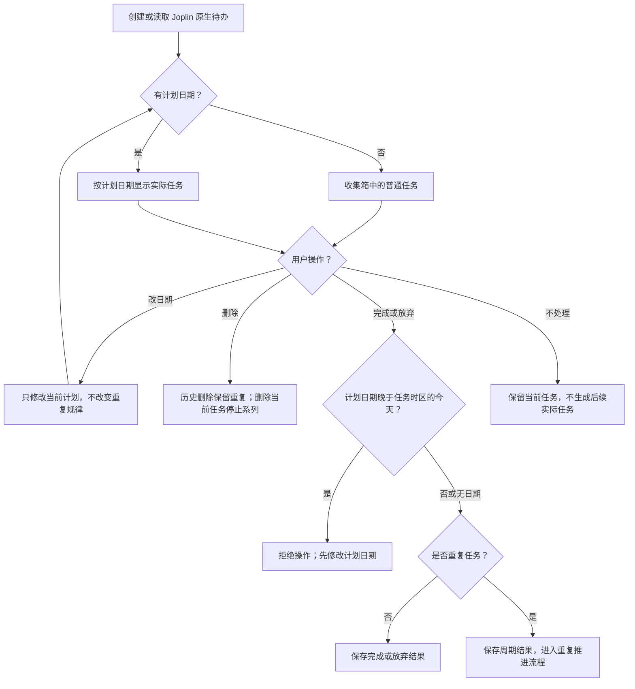
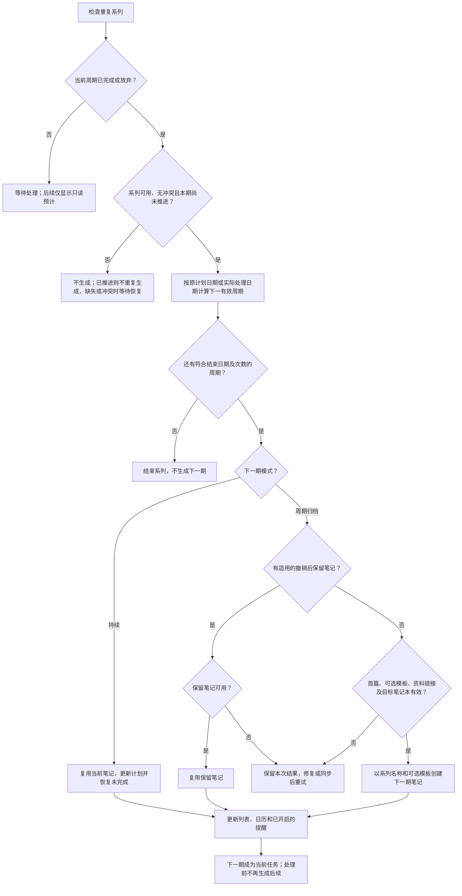
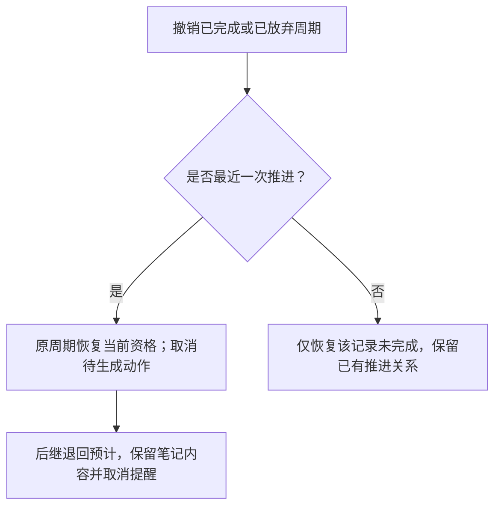

<h1 align="center">Journey Tasks · Joplin 任务增强插件</h1>

<p align="center">Journey Tasks 将 Joplin 原生待办集中显示为任务列表和日历，支持公历、农历重复任务、周期归档和原生提醒。<br />任务正文仍在 Joplin 中编辑。</p>

<p align="center">
  <a href="https://github.com/tigerwoo/journey-tasks-joplin-desktop/releases"></a>
  <a href="LICENSE"></a>
</p>

<p align="center"><a href="README.md">English</a> · <strong>简体中文</strong></p>

<p align="center"><strong>仅支持 Joplin Desktop 3.3+ · macOS / Windows / Linux<br />不适配 Android 和 iOS。</strong></p>

## 软件截图

**今天列表：**集中查看置顶、逾期和当天任务。


<details>
<summary>查看更多截图：周视图、年视图和任务菜单</summary>

**周视图：**查看已完成任务和重复任务的预计日程。


**年视图：**总览全年任务分布。


**任务菜单：**修改日期、查看任务日志、置顶、放弃、移动或删除任务。


</details>

## 安装

本插件只针对 Joplin **3.3 及以上桌面版（macOS / Windows / Linux）**设计和支持，**不适配 Android、iOS 等移动版**。

下载[最新版 Journey Tasks 安装包（`.jpl`）](https://github.com/tigerwoo/journey-tasks-joplin-desktop/releases/latest/download/io.journey.tasks.97d1cd8a-5ed4-4cc9-9bf8-f0b287db6cad.jpl)。若直接下载链接不可用，请到 [Releases 页面](https://github.com/tigerwoo/journey-tasks-joplin-desktop/releases)检查是否有包含 `.jpl` 安装包的版本。只需这个文件，无需解压、安装 Node.js 或运行源码。`publish` 中的 JSON 文件是发布信息，不需要安装。

### 桌面端（macOS / Windows / Linux）

1. 打开 Joplin 设置/选项，进入“插件（Plugins）”。
2. 点击“插件工具（Plugin tools）”齿轮，选择“从文件安装（Install from file）”。
3. 选择下载的 `.jpl`，按提示完全退出并重新启动 Joplin。
4. 确认 Journey Tasks 已启用。若未出现面板，使用“工具 → Journey Tasks → Journey：显示任务”。

可以使用 Joplin 的“更改应用布局”调整面板位置；拖动面板相邻的分隔线调整宽度。窄面板中可横向滚动查看完整日历。

Joplin 顶部笔记工具栏中的 Journey 路径勾选图标可切换显示／隐藏整个面板；“工具 → Journey Tasks → Journey：显示／隐藏任务”执行相同切换。“Journey：显示任务”始终打开面板。桌面版面板左上角的双箭头可隐藏主面板，切换为仅含无文字 SVG 恢复按钮的 32px 迷你栏，编辑区随之扩宽；恢复后保留原视图、筛选和主面板宽度。折叠时点击顶部 Journey 开关会隐藏迷你栏，再次点击则展开主面板。展开、折叠和关闭状态保存在本机，重启 Joplin 后恢复；首次使用默认展开。迷你栏是独立布局项，可在“更改应用布局”中单独移动；上下停靠时使用 36px 高恢复条。尺寸适配依赖 Joplin 内部布局类名，升级宿主后可能需要调整；不支持宿主样式接口的环境仍只收起内容。

### 更新

从文件安装新版 `.jpl` 并重启即可。多台桌面设备使用时应安装相同版本，避免不同版本同时管理同一系列。

## 核心原则：先处理当前周期，再生成下一期

- **当前任务未完成或未放弃，后续实际任务不会生成。** 逾期、刷新、同步或浏览未来日历都不会替你处理当前周期，也不会批量补建后续任务。
- 日历中的**“预计”只是只读预览**，不是已经生成的任务或笔记，不能完成、放弃，也没有提醒。只有前一期处理后，才可能成为下一期实际任务。
- **不允许完成或放弃未来任务**，普通任务和重复任务都适用。按任务时区比较计划日期与当天日期；今天的定时任务不必等到具体钟点，无日期普通任务可直接处理。如需提前执行，先将实际任务的计划日期改为今天或过去日期。
- 每次只推进一期；新生成的下一期仍需处理后才能继续推进。持续模式复用笔记，周期归档创建独立笔记；达到结束条件就不再生成。

## 开始使用

1. 打开任务面板，点击“新建”，填写标题并选择笔记本。
2. 按需设置计划日期、时间和提醒。不设日期的任务进入“收集箱”；不填时间表示全天任务。
3. 点击“保存并打开笔记”，在 Joplin 原生编辑器里填写正文、检查项、图片和附件。
4. 返回面板，点击任务编辑属性，勾选复选框完成任务。已有的 Joplin 原生待办也会显示，无需重新创建。
5. 需要重复时，先保存一项有计划日期的未完成任务，再在编辑界面开启重复并选择规则和模式。

也可在快捷添加栏输入标题，按 Enter 或点击栏内加号创建任务。栏内选项可设置今天、明天、指定日期或无日期，以及默认笔记本。快捷添加只创建全天或无日期任务，默认关闭提醒；添加时间和重复规则请打开任务编辑。

已有原生待办以原生闹钟作为初始计划时刻，没有闹钟的待办进入收集箱；交由插件管理后，计划日期与提醒覆盖值分开保存。普通笔记不会自动转为待办。

正文中的 Markdown 检查项由你管理，插件不会扫描、自动勾选或重置它们。

## 查看和整理任务

### 列表与日历

| 视图 | 显示内容 |
| --- | --- |
| 今天 | 今天任务及逾期未完成任务 |
| 明天 | 明天任务及逾期未完成任务 |
| 最近七天 | 从明天起连续七天的任务及重复任务预计日程，以及逾期未完成任务 |
| 收集箱 | 无计划日期的任务 |
| 所有 | 所有日期及无日期任务 |
| 日 / 周 / 月 / 年 | 对应日期范围内的任务及重复任务预计日程 |

今天、明天、最近七天及所有列表始终显示逾期未完成任务，收集箱只收录无日期任务；“已完成”开关控制完成项是否显示。完整任务行展示笔记本和原生标签，标签请在 Joplin 中编辑；面板支持笔记本多选筛选，勾选父笔记本包含全部子笔记本，也可单独选择子笔记本。搜索同时匹配显示标题与笔记原标题，空格分隔的多个关键词须全部命中。筛选会记住，搜索跨视图保留、重新打开面板后清空。列表按时间或笔记本分组，支持名称、创建时间、指定时间各自的升序和降序，共六种排序。默认时间分组＋指定时间升序；无日期任务按创建时间倒序，最新在前。重复任务及未来预览使用系列首篇笔记的创建时间。已完成任务遵循排序规则，未完成的置顶任务单独显示在顶部。日历保留日期布局，使用相同的筛选和搜索条件。原生标签筛选仍通过查询接口提供，暂无面板控件。

定时任务按当前设备时区显示；全天任务保持原日历日期。完成资格按任务保存的时区判断，因此显示日期可能与资格判断使用的日期不同。定时任务到达计划时刻即视为逾期；全天任务到任务时区的次日才视为逾期。日历中的逾期任务仍留在对应计划日期。周视图从周日开始；点击月视图周号进入周，点击日期进入日，点击年视图月份进入月，也可返回上层。

“预计”表示尚未生成的未来周期，只供查看，不能勾选，也没有提前创建笔记或安排通知。按完成日期重复的远期日程只是估算。“日历”显示选项切换公历／农历日期标签，周、月、年网格仍按公历排列；它与设置中的默认输入日历相互独立。实际任务与预计周期分别计数。

### 任务菜单与多选

桌面端右键任务，或点击任务旁的 **⋯** 打开菜单。

| 操作 | 作用 |
| --- | --- |
| 日期 | 改为今天、明天、七天后或指定日期和时间；普通任务可清除日期。重复任务必须保留日期，改期只影响本期执行计划，不改变重复规律 |
| 置顶 / 取消置顶 | 在所选列表视图内优先显示本次任务；完成后清除，下一周期不继承 |
| 放弃 | 标记原生待办完成，重复任务将结果记为放弃并继续推进；不改正文 |
| 移动到 | 将选中的笔记移动到指定笔记本，不改变系列后续任务的生成位置 |
| 删除 | 删除历史记录不停止重复：共享笔记的历史行仅移除展示，执行结果保留；独立历史笔记移入回收站。删除历史首篇会暂停后续生成，恢复首篇可继续。删除当前任务会停止系列，其他周期笔记保留，被删除笔记不会自动重建 |

在列表、日、周、月视图中，按住 **Cmd（macOS）或 Ctrl（Windows/Linux）** 点击任务可多选，再次点击取消选择。右键已选任务或点击其 ⋯ 可批量改日期、置顶、放弃、移动和删除；右键未选任务仅操作该任务。

今天、明天、七天后快捷操作保留各任务原有时间和时区；指定日期弹窗会将选定时间统一应用到所有选中任务，时间留空则统一改为全天，各任务已有时区保持不变。混合置顶状态统一置顶。按 Escape、点击空白或切换视图可清除选择。批量操作中途失败会停止并显示进度，请核对已处理项后重新选择剩余任务。已完成任务及历史周期不能通过日期菜单改期；重复任务不能清除日期。

## 重复任务

在「编辑系列」中选择「系列笔记本」并保存，会将首篇、当前期和所有已生成的历史笔记一起移动，包括此前单独移到其他笔记本的笔记；后续任务也在目标笔记本生成。仅修改其他规则、不操作笔记本选项，不会触发归拢。移动不改变笔记ID、模板关联或周期起算日期。部分移动失败会保留恢复记录，刷新或重启后重试；不会恢复回收站中的历史笔记。

重复任务必须有计划日期。可以设置公历日、周、月、年重复及间隔、多选星期、普通工作日/周末、月末、第 N 个星期；农历支持月、年重复、闰月、小月取月末和除夕。普通工作日指周一至周五，不包含法定节假日调休。

重复可按计划日期或完成日期计算，并设置结束日期、次数或一直重复。新建有日期任务自动使用当前设备时区，表单只读展示；编辑时保留任务原有时区，换设备或旅行时也不会覆盖。该固定时区用于计划和提醒计算；无日期任务首次设置日期时采用设备时区。农历输入会提供公历对照。农历转换和重复限定在公历 1901-01-01 至 2099-12-31 范围内，并要求 Joplin 运行环境支持中国农历。

### 选择持续模式还是周期归档

| 模式 | 完成本次后的行为 | 适用场景 |
| --- | --- | --- |
| 持续模式 | 复用同一篇待办，更新为下一周期；保留正文 | 买药、缴费等只需一篇长期笔记的任务 |
| 周期归档 | 保留本次笔记，创建下一期独立待办 | 巡检、周报等每期需要单独记录的任务 |

修改重复规则或起算日期会影响后续周期和预计日程，不会自动改变本期执行日期。需要调整本期时，请明确修改「编辑系列」中的本期日期／时间，或使用任务日期菜单。仅修改名称、提醒或模式也不会重置本期日期。既有历史记录、笔记及正文保留，模式切换在下一次推进时生效。重复次数包含首期，结束日期包含当天。指定日期超过当月天数时取月末；指定的第 5 个星期超过月末时也取月末。农历按年重复指定闰月时，没有对应闰月的年份使用同名普通月份。

### 为归档任务准备正文模板

模板可选。不设置模板时，后续任务使用系列名称，正文为空。需要每期复制检查清单时：

1. 在任务编辑界面选择周期归档，点击“插入模板区块”。已有系列可在“编辑系列”中操作。
2. 在打开的 Joplin 笔记中，填写两个标记之间的内容：

```md
<!-- template:start -->
- [ ] 检查设备
- [ ] 记录读数：
<!-- template:end -->
```

3. 返回插件，保存归档重复设置。首次保存含非空模板的归档设置，会在系列首篇中将模板内容复制一次到开始标记上方，作为可编辑的执行内容；重复保存不会再次复制。
4. 模板外的执行副本可直接在 Joplin 中编辑；修改标记内的模板，只影响以后生成的新任务。

示例外围的三反引号不用复制。下一期正文只取模板标记之间的内容，不复制标记和模板外执行记录；默认勾选状态按原样保留。空模板会生成空正文。请保留完整的一对标记，损坏时需修复后重试。

也可在原生编辑器中使用“工具 → Journey Tasks → 插入模板区块”：选中的文字会放入区块，无选中内容则插入空区块。请在普通 Markdown 段落处使用，避免放入代码围栏。插入区块本身不会启用重复。

保存归档设置或生成下一期时，模板中的内嵌图片、媒体及 Joplin 附件资源链接会被拒绝。共用资料请放入独立笔记并在模板中链接；链接的 Joplin 笔记须已同步、解密且未进入回收站。模板外的执行内容仍可正常添加附件。

### 系列改名

在插件内修改重复任务名称，会更新整个系列：首篇、当前、中间及历史笔记、撤销后保留的后继笔记标题，以及历史和预计展示、以后生成的任务名称。只改标题，正文、日期、完成状态和周期身份不变；其他同名任务不受影响。部分笔记尚未同步、无法解密或写入失败时，会显示待更新数量，恢复可用后刷新重试。不会为改名恢复已删除笔记。

历史状态按实际生效的计划重建，修改名称、提醒和模式不会还原计划日期。请保留系列首篇；首篇不可用或系列数据冲突时，系统会暂停推进并提示。

## 任务如何处理

### 从创建到完成



### 重复周期推进

插件只在当前周期被完成或放弃后推进。今天及过去日期的任务可处理，未来任务需先修改计划日期；判断使用任务时区，今天的定时任务不必等到具体钟点。无日期普通任务可直接完成。单纯逾期或浏览未来日历不会生成下一期。



按计划日期重复时，严格取本周期在规则中的下一期，即使下一期已经逾期。例如 10 月 28 日处理每周重复的 10 月 12 日任务，下一期是 19 日，再处理后是 26 日，而后才是 11 月 2 日；每次操作只生成一代。按完成日期重复时，以实际处理日期重新计算。单次改日期只改变执行日期，不改变该周期在原规则中的位置。

放弃本期后继续重复；不再需要后续任务时请选择“结束重复”：保留已有笔记和执行记录，停止预计与生成，并清除本期原生提醒。放弃只记录插件状态，不在正文追加说明。开启“已完成”后，列表和日历会将放弃记录作为已处理项显示，完成和放弃的区别可在任务日志中查看；持续模式历史按周期单独显示，不会给共享笔记额外安排提醒。

撤销最近一次处理会恢复原周期为当前任务，下一期退回只读预计并取消提醒；归档模式已创建的后继笔记仍保留，失去执行资格，再次推进相同周期时优先复用。若本期已处理但后继生成失败，撤销只恢复本期未完成状态。撤销更早历史只修正该记录，不影响其他周期，再次完成历史也不会生成后继。匹配的保留后继笔记不可用时，须恢复原笔记后重试。



Joplin 原生界面完成今天或过去的当前周期，会按正常操作推进。勾选未来周期时，插件发现后恢复未完成并提示，不生成后继；插件不运行时无法立即纠正。持续模式的原生复选框始终对应最新周期，修改历史请使用插件执行记录入口。离线完成还会核对实际完成日期，避免同步延迟绕过日期限制。

插件不会因完成、放弃或撤销而自动改写既有标题正文。首次保存含非空模板的归档设置（含从持续模式切入）会在首篇模板上方插入一次执行副本，保留模板和原有区外内容。创建归档新笔记时可写入模板初始内容；“插入模板区块”和显式保存标题等用户编辑操作会按操作意图修改。

## 任务日志

所有任务（包括单次任务）均可从右键菜单或编辑窗口打开「任务日志」。时间线展示可用的创建时间、计划日期与重复规则的修改前后值，以及实际完成、放弃和取消操作的时间；重复任务的逐期执行记录合并在同一份倒序日志中，其周期记录提供撤销状态和打开笔记按钮；单次任务日志只读，撤销单次任务请开启“已完成”后在列表中取消勾选。已有操作日志可直接展示，未记录的历史修改无法补全。事件时间戳按当前设备时区显示，修改前后的计划值保留保存时的日期和时间。

## 提醒

新建任务的提醒默认关闭；全天任务开启提醒时默认当天 09:00，定时任务的常规提醒在计划时刻触发，编辑窗口还提供稍后十分钟提醒。开启常规提醒前必须设置计划日期。系统通知由 Joplin 原生提醒负责，插件没有独立后台通知服务。

计划日期与提醒时刻分别保存：关闭提醒后，Joplin 原生界面可能显示无日期，但插件仍保留计划；稍后提醒只修改提醒时刻。已由插件管理的任务在 Joplin 原生界面修改闹钟，也只覆盖提醒时刻，不改变插件计划日期。未来预计项不安排提醒。插件不运行时不会生成后续周期，已有提醒能否在后台、锁屏或强停后送达取决于 Joplin 和操作系统。

## 设置、同步与数据

右上角设置可选择语言（跟随 Joplin，或以下 26 个语言／地区选项）、固定启动视图或恢复上次视图、新建默认公历/农历，以及 12／24 小时时间显示。点击“保存”生效，“取消”丢弃修改。切换语言后面板即时更新，宿主菜单名称需重启 Joplin 更新。

- 标题、正文、笔记本、标签、完成状态和提醒使用原生笔记数据。
- 计划、置顶、重复规则、周期关联和执行历史保存在笔记的插件元数据（userData）中，随 Joplin 同步；复制正文不会复制这些数据。
- 归档模板在系列首篇正文中，请保留首篇。两种模式都由原始首篇承载系列数据，切换模式不会迁移关联。
- 语言、视图偏好和本机恢复记录各设备独立，不随任务同步。

多设备操作前后请完成同步。离线并发可能产生重复候选或规则冲突，插件会归并可确认的结果，遇到冲突则暂停推进并提示处理；无法保证多台设备任何时刻只有一篇物理笔记或通知只响一次。


### 支持的界面语言

| 代码 | 语言／地区 | 代码 | 语言／地区 |
| --- | --- | --- | --- |
| `zh-CN` | 简体中文 | `zh-TW` | 繁體中文 |
| `en` | English | `en-GB` | English (United Kingdom) |
| `en-US` | English (United States) | `ca` | Català |
| `hr` | Hrvatski | `da` | Dansk |
| `de` | Deutsch | `es` | Español (España) |
| `fi` | Suomi | `fr` | Français |
| `id` | Bahasa Indonesia | `it` | Italiano |
| `hu` | Magyar | `nl` | Nederlands |
| `fa` | فارسی | `pl` | Polski |
| `pt-BR` | Português (Brasil) | `ro-MD` | Română (Republica Moldova) |
| `ro-RO` | Română (România) | `sk` | Slovenčina |
| `sv` | Svenska | `tr` | Türkçe |
| `ru` | Русский | `ja` | 日本語 |

语言列表以 [注册表](src/i18n/registry.ts) 为准。自动模式先精确匹配 Joplin 的语言，再尝试匹配支持的同语种选项；无法匹配或无法读取 Joplin 语言时，回退到美式英语（`en-US`）。翻译随插件离线提供。切换语言不翻译用户的笔记内容，也不改变计划和重复规则。

## 清理与卸载

仅卸载插件不会删除任务笔记，也不会自动清除插件元数据。若希望移除规则、历史和本机设置，请在卸载前操作：

1. 停用其他设备上的本插件并完成同步。
2. 打开设置 → 数据管理 →“清理本插件数据”。
3. 阅读警告，预览笔记、笔记本和元数据键的数量。
4. 输入 `RESET` 确认，等待结果。预览在五分钟后或相关数据变化后失效。清理前请完成同步和解密，未解密的笔记或笔记本会阻止清理；部分失败时重新预览并重试。
5. 清理成功后，在 Joplin 插件设置中卸载并重启。其他设备的本机设置需要分别处理。

清理保留用户笔记、笔记本、正文、标签和原生完成状态，清除范围内任务的原生日期、提醒及当前插件命名空间的数据，并重置本机偏好和恢复记录。未完成任务会立即进入收集箱，无需重启。此前清理留下的当前插件命名空间删除标记仍可用于识别和补清残留提醒；没有该标记的其他原生待办不在清理范围内。清理会同步到其他设备，已移除的规则和历史无法通过重装恢复。Joplin 仍可能保留同步删除标记和笔记历史。

## 常见问题

- **看不到面板或安装失败**：确认安装的是 `.jpl`，检查 Joplin 版本和插件启用状态，完全退出后重启；桌面可从“工具 → Journey Tasks”打开面板。
- **原生待办没有出现**：点击面板刷新，检查日期范围和“已完成”开关，并确认笔记为待办、已同步解密且未进入回收站或冲突区；无日期任务请查看收集箱。
- **完成后没生成下一期**：检查系列是否已结束，阅读错误提示，完成同步并恢复缺失的首篇；模板标记损坏时先修复，再使用“重试生成下一期”。请勿通过反复完成历史任务补生成。
- **批量操作失败**：核对菜单显示的进度，关闭菜单后重新选择尚未处理的任务。
- **没有系统通知**：确认开启任务提醒和 Joplin 的系统通知权限；后台与省电设置也会影响投递。
- **需要反馈错误**：提供 Joplin/系统版本、操作步骤和错误原文；桌面可通过“帮助 → 切换开发者工具”查看 Journey 相关错误。

<h2 align="center">请我喝杯咖啡</h2>

<p align="center">如果 Journey Tasks 对你有帮助，欢迎支持后续开发。感谢你的支持！</p>

<p align="center"><a href="https://buymeacoffee.com/tigerwoo">请我喝杯咖啡</a><br />点击链接或扫描下方二维码</p>

<p align="center">
  <a href="https://buymeacoffee.com/tigerwoo"></a>
</p>

## 开源协议

Journey Tasks 使用 [MIT 协议](LICENSE)。
